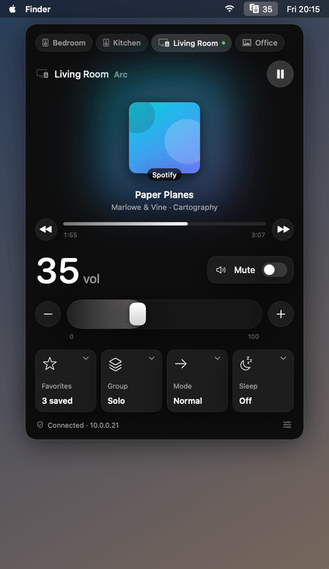
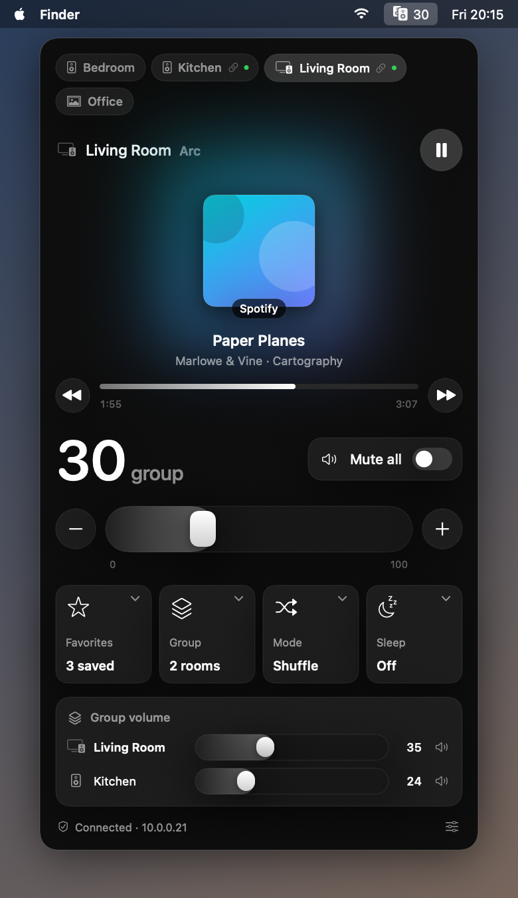

# SonosPanel

A native macOS menu bar panel for Sonos speakers. Everything runs over the local network; no Sonos account or cloud API.

<p align="center"></p>

## Features

- Automatic discovery (SSDP `ZonePlayer`), re-run every 5 minutes; manual "add by IP" for players on another subnet
- One pill per room, with a link icon when grouped and a green dot while playing
- Now playing: album art, title, artist, album, source (Spotify, Spotify Connect, AirPlay, Radio, TV, Line-In, …)
- Play / pause, previous / next, tap the progress bar to seek
- Volume slider, − / + and mute; when rooms are grouped they move the whole group together, keeping each room's offset
- Group volume card to adjust or mute a single room inside a group
- My Sonos favorites (stations play directly; playlists and albums replace the queue)
- Grouping: add or remove rooms, group all, play here only
- Play mode (shuffle / repeat) and sleep timer
- Menu bar shows the selected room's (group) volume while it plays

<p align="center"></p>

## Install

Download `SonosPanel-1.0.0.dmg` from the [latest release](https://github.com/flightlesstux/SonosPanel/releases/latest), open it and drag **SonosPanel** to **Applications**.

The app is not notarized. On first launch, right-click SonosPanel in Applications and choose **Open**, or run:

```sh
xattr -dr com.apple.quarantine /Applications/SonosPanel.app
```

## Requirements

- macOS 14 or later
- Xcode command line tools (Swift 5.10+)

## Build and run

```sh
git clone https://github.com/flightlesstux/SonosPanel.git
cd SonosPanel
./build.sh
open build/SonosPanel.app
```

On first launch allow **Local Network** access when macOS asks
(System Settings → Privacy & Security → Local Network).

## How it works

| Transport | Used for |
|---|---|
| SSDP `M-SEARCH` for `urn:schemas-upnp-org:device:ZonePlayer:1` | Discovery |
| `GET http://<player>:1400/xml/device_description.xml` | Model name |
| `ZoneGroupTopology#GetZoneGroupState` | Rooms, groups, coordinators |
| `AVTransport` (on the group coordinator) | Transport state, track, play/pause/next/seek, play mode, sleep timer, favorites playback, grouping |
| `RenderingControl` (per room) | Volume and mute |
| `ContentDirectory#Browse FV:2` | My Sonos favorites |

All SOAP calls go to `http://<player>:1400`. Playback commands are sent to the group coordinator; volume and mute to each room.

## Storage

Discovered rooms and the selected room are kept in the app's user defaults (`com.flightlesstux.SonosPanel`).

## Debug flags

```sh
.build/release/SonosPanel --snapshot <dir>                    # render every room's panel to PNG and exit
build/SonosPanel.app/Contents/MacOS/SonosPanel --demo-frames <dir>  # render the demo walkthrough frames
scripts/make-demo-gif.sh                                      # rebuild docs/demo.gif (needs ffmpeg)
scripts/make-dmg.sh                                           # build build/SonosPanel-<version>.dmg
```

The demo GIF and screenshot use built-in sample rooms, so they never show real room names, addresses or album art.

## License

MIT
